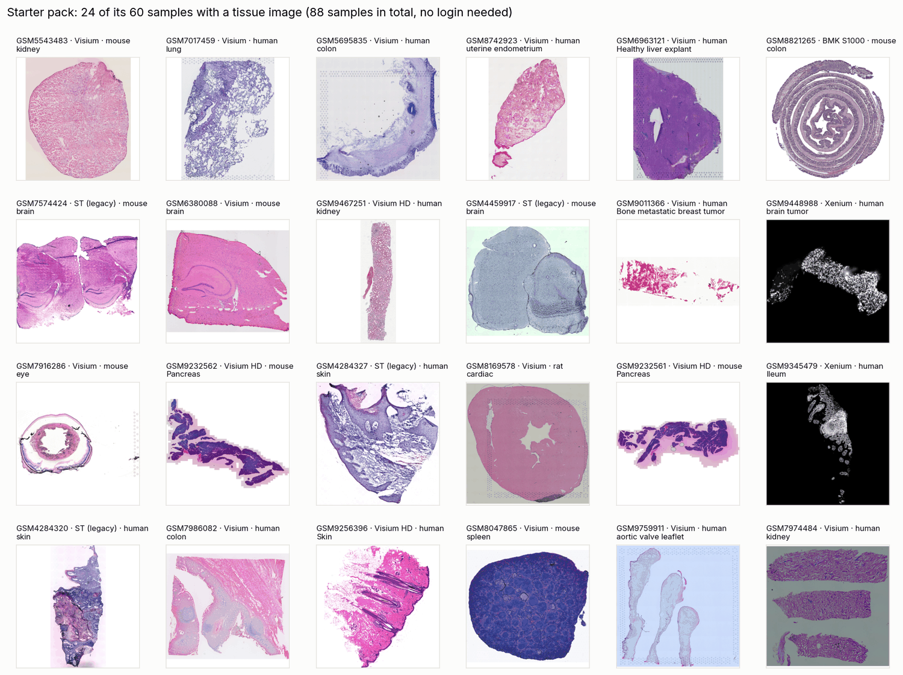
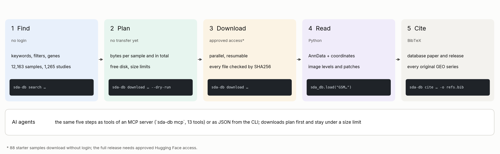
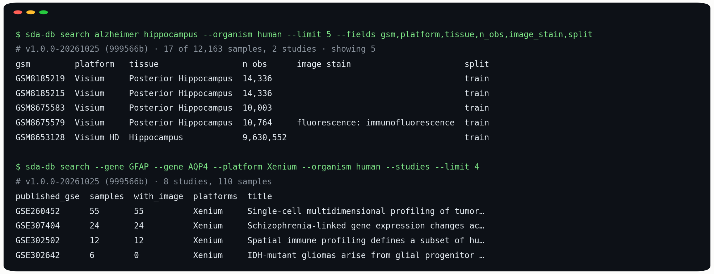
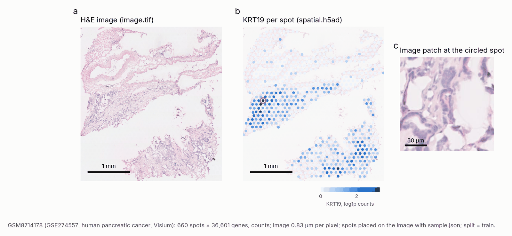
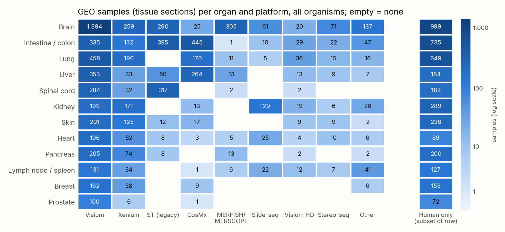
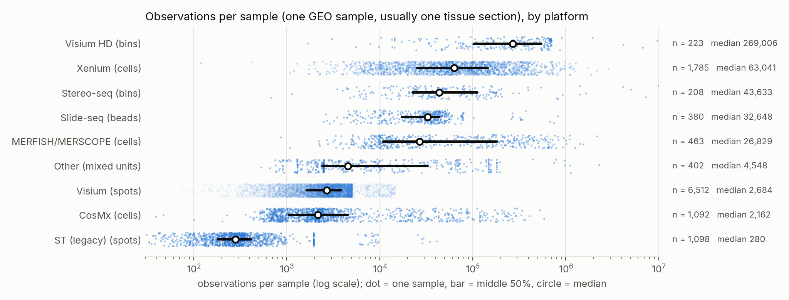

# SpatialDataAgent-DB toolkit

[](https://github.com/Biogod2020/spatial-data-agent-db/actions/workflows/tests.yml)
[](https://huggingface.co/datasets/Biogod/SpatialDataAgent-DB-Catalog)
[](https://doi.org/10.64898/2026.05.27.727615)
[](LICENSE)

Find, download, verify, read and cite samples from SpatialDataAgent-DB, a versioned atlas of
public spatial transcriptomics. The paper release holds **12,163 samples from 1,265 GEO studies**
(NCBI GEO: a study is a GSE series, a sample a GSM) in 12 platform
groups: Visium, Visium HD, Xenium, CosMx, MERFISH/MERSCOPE, Slide-seq, Stereo-seq, legacy ST and others.
**8,211 samples have a registered tissue image, 5,263 of them H&E.** Every sample has verified expression,
coordinates and release metadata. The [public catalog](https://huggingface.co/datasets/Biogod/SpatialDataAgent-DB-Catalog)
is open to everyone; the [full dataset](https://huggingface.co/datasets/Biogod/SpatialDataAgent-DB) needs approved
access.



**Searching needs no account, and neither does the 88-sample starter pack above.** Downloading the full release
needs approved access ([below](#access)).

[中文说明](README_zh.md) · [CLI](docs/cli.md) · [Python API](docs/python-api.md) ·
[AI agents and MCP](docs/agents.md) · [Cookbook](docs/cookbook.md) · [Data dictionary](docs/data-dictionary.md) ·
[Streaming](docs/streaming.md) · [Validation](docs/validation.md) · [Changelog](CHANGELOG.md)

## How it works



One package serves three kinds of users:

- **People** use a Python API and a CLI that prints readable tables.
- **Scripts** get JSON output, stable error codes and replayable selections.
- **AI agents** get a Model Context Protocol (MCP) server, compact JSON and an agent skill, so assistants such as
  Claude Code or Codex can search, plan downloads and read samples safely.

## Install

Python 3.11 or later:

```bash
pip install "spatial-data-agent-db[analysis] @ git+https://github.com/Biogod2020/spatial-data-agent-db"
```

The `analysis` extra adds AnnData, NumPy, pandas and tifffile for reading samples. Searching and downloading need
only the core install. To run the CLI without installing anything:

```bash
uvx --from "git+https://github.com/Biogod2020/spatial-data-agent-db" sda-db search alzheimer
```

## Try it in five minutes, without an account

The starter pack contains 88 representative samples of the paper release:

- 12 platforms, 20 organ groups and 8 species;
- 60 samples with a tissue image, 46 of them H&E and 8 at cell resolution (≤ 1 µm per pixel);
- 4.5 GB in total.

Its files are byte-identical to the gated release.
[Open the starter notebook in Colab](https://colab.research.google.com/github/Biogod2020/spatial-data-agent-db/blob/main/examples/starter_pack.ipynb),
or:

```bash
sda-db starter --has-image                                    # list the pack
sda-db download GSM6963121 --release starter --include-image  # human liver, Visium H&E at 0.88 µm per pixel
sda-db inspect GSM6963121 --release starter                   # shape, coordinates, QC, image levels
```

In Python the same sample is one line: `adata = sda_db.load("GSM6963121", release="starter", include_image=True)`
(leave out `include_image` to fetch expression only).

## Command line in one minute



*Real output (with `--limit 5 --fields …` for a narrow table): a ranked keyword search with one filter, and a gene search that groups the results by study.
Neither needs a login.*

```bash
sda-db search alzheimer hippocampus --organism human        # ranked; no download, no login
sda-db values tissue --platform Xenium --top 15            # learn the vocabulary of a field
sda-db search --gene GFAP --gene AQP4 --platform Xenium    # samples whose panel measures both genes
sda-db features GSM9448988 --contains CD                   # genes a sample measures, without downloading
sda-db show GSM8185219                                     # everything about one sample
sda-db download GSM8185219 --dry-run                       # sizes before any transfer
sda-db download GSM8185219                                 # verified against SHA256, with a receipt
sda-db inspect GSM8185219                                  # shape, coordinates, QC, image levels
sda-db search --stain "H&E" --where "split=train" --output he_train.json   # 3,847 H&E training samples
sda-db search --platform "visium hd" --has-image --output cohort.json
sda-db download --from cohort.json --include-image --max-size 100GB
sda-db cite --from cohort.json -o refs.bib                 # database + every original study
sda-db doctor                                              # login, access, disk, network
```

The CLI prints a table on a terminal and compact JSON when its output is piped. Scripts and agents should pass
`--json` to be sure. Results go to stdout, and logs and errors go to stderr; an error is JSON with a stable `code`.
A search result looks like this (shortened):

```json
{"release": "v1.0.0-20261025", "commit": "999566bf…", "filters": ["image_stain=H&E", "has_image=True", "split=train"],
 "total": 3847, "shown": 2, "truncated": true,
 "samples": [{"gsm": "GSM4284316", "published_gse": "GSE144239", "platform": "ST (legacy)", "organism": "Homo sapiens",
              "tissue": "skin", "disease": "cSCC", "n_obs": 666, "image_stain": "H&E", "split": "train", "…": "…"}],
 "next": ["repeat with --output cohort.json to save all 3847", "…"]}
```

An error looks like
`{"error": {"code": "not_found", "message": "...", "hint": "Run 'sda-db download GSM6963121' first."}}`.
Commands compose through IDs:

```bash
sda-db search lung --platform Xenium --format ids | sda-db download --from - --dry-run
```

See the [CLI reference](docs/cli.md) for every option, JSON envelope and exit code.

## Python in one minute

```python
import sda_db

adata = sda_db.load("GSM6963121", release="starter")   # no login; expression only, saved to ./downloads

catalog = sda_db.open_catalog()                  # v1.1.0-20261105: paper data + metadata v2; no login
hits = catalog.search("alzheimer hippocampus", organism="human", has_image=True)
print(hits)                                      # <Catalog release=v1.1.0-20261105 commit=999566b samples=... >
fibrosis = catalog.search(organ="lung", disease="fibrosis", min_confidence=0.6)   # curated fields (below)
paper = sda_db.open_catalog("paper")             # the paper release exactly as published
hits.to_pandas()[["gsm", "tissue", "disease", "n_obs", "score"]]
hits.list_studies()                              # one row per GEO series, with titles and PubMed IDs

train = catalog.search(image_stain="H&E", split="train")   # 3,847 H&E training samples

# The next two lines need approved access to the full dataset:
print(hits.plan_download(include_image=True).to_dict(per_sample=False))   # bytes before transfer
report = hits.download("downloads", include_image=True, max_bytes="50GB")
```

Every sample folder holds `spatial.h5ad` (expression with coordinates) and `sample.json` (units, QC and
provenance). The 8,211 samples with an image also hold `image.tif`, and their `sample.json` gives the transform
that places each spot or cell on the image. Images are downloaded only with `include_image=True`.

- `load()` returns a standard AnnData (matrix plus annotations) and the image stays a TIFF; you do not need
  scverse SpatialData.
- Scanpy (`import scanpy as sc`) plots the coordinates in `obsm['spatial']` with
  `sc.pl.embedding(adata, basis="spatial")` or `sc.pl.spatial(adata, spot_size=...)`.
- The image is not stored in `adata.uns['spatial']`, so `sc.pl.spatial` does not draw it. To overlay it, use
  `image_coordinates()` and the image helpers, which also cut patches paired with expression.



*a, H&E image. b, KRT19 counts per spot, placed on the image by `sample.json`. c, a patch at the circled spot.
The example is GSM8714178 (human pancreatic cancer, Visium, 0.83 µm per pixel).*

This snippet runs without login on a starter sample:

```python
import json
import sda_db
from sda_db.image import read_patch
from sda_db.io import image_coordinates

adata = sda_db.load("GSM6963121", release="starter", include_image=True)   # saves to ./downloads, verifies
meta = json.loads(adata.uns["sda_db"]["sample_json"])   # stored as a JSON string
pixels = image_coordinates(adata, meta)          # full-resolution (level-0) pixels of every spot
# "directory" is the sample folder that holds image.tif. The size is 224 level-0 pixels;
# info["um_per_px"] (0.88 here) converts it to microns.
patch, info = read_patch(adata.uns["sda_db"]["directory"], pixels[0], 224)
```

For many samples under a disk budget, `catalog.stream(...)` delivers verified samples one at a time and
prefetches the next ([streaming](docs/streaming.md)). See the [Python API](docs/python-api.md) and the
[cookbook](docs/cookbook.md) for cohorts, splits, images and more.

## AI agents

Register the MCP server once and an agent can search, inspect, plan, download and cite:

```bash
claude mcp add sda-db -- sda-db mcp --download-dir ./sda-downloads --max-download-size 50GB   # Claude Code
```

If `sda-db` is not on the agent's PATH, register it through uvx instead:

```bash
claude mcp add sda-db -- uvx --from "git+https://github.com/Biogod2020/spatial-data-agent-db" \
  sda-db mcp --download-dir ./sda-downloads --max-download-size 50GB
```

The server needs no extra packages. Search returns 20 rows by default (at most 200) and gene lists 100 (at most
2,000), each with a `truncated` flag, so results stay small in an agent's context.

It offers 13 tools: `search_samples` (keywords, filters and genes), `field_values`, `list_fields`, `summarize`, `get_sample`, `get_study`, `list_features`, `plan_download`,
`download_samples`, `inspect_sample`, `cite`, `list_releases` and `check_access`. Downloads are plan-first. A call to
`download_samples` without `confirm=true` only returns the plan; a second call with `confirm=true` transfers. The
agent can make that second call itself, so the real guard is set by you when you start the server: it refuses
any call above `--max-download-size` (default 20GB) and writes only under `--download-dir`.
`--no-allow-downloads` removes the download tool. Configuration for Claude Desktop, Codex, Cursor,
Gemini CLI and VS Code is in [AI agents and MCP](docs/agents.md). An agent without MCP can use the JSON CLI
with the [agent skill](skills/sda-db/SKILL.md).

## What is in the atlas



*Samples whose GEO tissue text matches each organ, by platform. The separate right column counts
the human samples within each row.*



*Observations per sample. A sample is one GEO sample, usually one tissue section, and observations are spots,
bins, beads or cells depending on the platform.*

## Search

| Syntax | Meaning |
|---|---|
| `alzheimer hippocampus` | Ranked keywords (BM25) over tissue, disease, organism, platform, IDs and study title/design/summary. Every term must match. |
| `"spinal cord"` · `-mouse` · `neuro*` | Phrase · exclude · prefix |
| `--platform "visium hd"` · `--organism human` | Exact values. Case, spaces and hyphens are ignored, and common names work. Repeat for OR. |
| `--tissue cortex` · `--disease glioma` | Case-insensitive substring of the GEO text |
| `--gene GFAP --gene AQP4` (`--gene-any`) | Samples that measure these features: symbols or Ensembl IDs, any case. Measured is not the same as detected. |
| `--where "n_obs>=50000"` · `"split=train\|val"` · `"disease="` | Any field: `=`, `!=`, `~` (contains), `!~`, `>`, `>=`, `<`, `<=`, `\|` for OR, empty for missing |

Search is deterministic. It runs offline after the first catalog download and makes no model calls.

- A misspelled field or controlled value fails with suggestions, e.g. `platform='Visum'` →
  `'Visium', 'Visium HD'`.
- Terms that match nothing are reported, not silently dropped.
- The study-level [intent search](https://github.com/YSTLab/spatial-data-agent) of the paper is a separate,
  model-based tool.

## Curated metadata v2

The default release `v1.1.0-20261105` is the paper release (same commit, same files) plus a curated metadata
table, [metadata v2](https://huggingface.co/datasets/Biogod/SpatialDataAgent-DB-Catalog/tree/main/metadata/v2)
(tag `metadata-v2-20261105`). It is joined to every sample by GSM and adds:

- `organ` (fixed list of 43), `tissue_ontology_id`/`_name` (UBERON) and `sample_kind` (primary tissue, tumour
  tissue, metastasis, organoid, xenograft, ...);
- `disease_status` (normal / disease / perturbation / not stated) and `disease_ontology_ids`/`_names` (MONDO);
- `life_stage`, harmonized `sex`, `donor_key`; `organism_taxon_id`, `organism_common_name`, `organisms`;
- `assay_name`, `assay_type` (imaging- or sequencing-based), `preservation` and PubMed IDs;
- a corrected `platform` for 204 samples (the release value stays in `platform_v3`, likewise `organism_v3`,
  `sex_v3`);
- per-field confidence, `annotation_low_confidence` and `metadata_flags`.

```bash
sda-db search human lung fibrosis Visium                     # keywords also match organ, UBERON and MONDO names
sda-db search --organ lung --disease fibrosis --min-confidence 0.6
sda-db search --disease MONDO:0004975 --disease-status disease --exclude-flags
sda-db values organ --sample-kind "tumour tissue"
```

`--disease` takes a MONDO ID or name; names also match as case-insensitive substrings. Parent terms are not
expanded, so `--disease cancer` does not find "carcinoma". `--where "disease~TEXT"` still searches the disease
text reported in GEO. `--organism` accepts a scientific name, a common name or a taxon ID, and matches every host
species listed for a sample. `--min-confidence 0.6` removes all low-confidence calls. `--exclude-flags` removes
flagged samples; pass flag names to remove only those flags.

In a QA set of 300 random samples, the wrong rate per field was: organ 0.3%, tissue term 0.7%, sample
kind 0.7%, life stage 1.7% and disease 3.0%. Known limitation: a study-level disease sometimes reaches a control
sample that its own record does not mark as a control (about 1.5% of samples). Check `disease_status_source` and
the GEO text when the control/disease split matters.

**The paper release is still available unchanged:** `--release paper` (or `v1.0.0-20261025`) gives the v3
metadata only, exactly as in the paper. `sda-db cite` names the metadata v2 tag whenever v2 is used.

## Releases and reproducibility

| Release | Commit | Samples | Notes |
|---|---|---:|---|
| `v1.1.0-20261105` (default; aliases `metadata-v2`, `v1.1`) | `999566b` | 12,163 | Paper data and files plus curated metadata v2 (tag `metadata-v2-20261105`) |
| `v1.0.0-20261025` (aliases `paper`, `v1`) | `999566b` | 12,163 | Paper release as published (v3 metadata); its catalog is open and SHA256-bound, its files need access |
| `latest` | resolved at open | grows | Rolling release with reviewed daily additions; needs access |

Every selection, download and citation records its release name and full commit. Use `--release` or
`open_catalog(release=...)` to choose one. `Catalog.from_selection("cohort.json")` reopens the same release,
commit and samples. A bare commit such as `999566b…` opens the paper release without metadata v2. Downloads go to `downloads/<commit>/samples/<GSE>/<GSM>/` with a receipt of every file hash.

## Access

Files of the full release are on Hugging Face and require **manual approval with an institutional e-mail**:

1. Request access at the [dataset page](https://huggingface.co/datasets/Biogod/SpatialDataAgent-DB).
2. When approved, run `hf auth login`, or set `HF_TOKEN`.
3. Run `sda-db doctor` to confirm.

Keep tokens out of scripts and command arguments. See [access and troubleshooting](docs/access.md).

## Interpret the data correctly

- `X` is not raw counts everywhere. Check `expression_state` (counts / non-integer / unknown) and `verification`.
- `obsm['spatial']` keeps its original units (`coordinate_units`: um / pixel / native_grid / unstated).
  Micrometres exist only where recorded, and `um_basis` says how they were obtained.
- Observations are spots, bins, cells or beads (`observation_unit`), not cells everywhere.
- Images are optional and opt-in. `image.spatial_to_pixel` maps native x/y to level-0 pixels.
  Heuristic stain labels say so.
- For machine learning keep the release `split`, which assigns whole GEO series to train, val or test, and keep each
  study together. `aliases` lists other GSMs that hold identical content to a sample, and `content_group` names
  that group. The release keeps one sample per group, so these IDs need no further dedup.
- Verification, image registration and human review are separate fields, and an empty review is not a PASS.

See the [data dictionary](docs/data-dictionary.md) and [reuse guide](docs/reuse.md).

## Cite

`sda-db cite` writes BibTeX for the database paper, the release and every GEO series of a selection. Cite the
original studies as well. The paper:

> Ji J-H, Zou Q, Cheng J, et al. *An agent-built, verified atlas of public spatial transcriptomics shows
> that breadth across studies drives transfer and reproducibility.* bioRxiv (2026).
> [doi:10.64898/2026.05.27.727615](https://doi.org/10.64898/2026.05.27.727615)

## License

The toolkit code is under the [MIT License](LICENSE). The data keep the terms of the dataset card and of the
original studies; this license does not cover them.

## Development

```bash
python -m pip install -e '.[analysis]'
python -m unittest discover -s tests -v
```

Tests are offline with synthetic payloads. They cover search, filters, releases, plans, parallel downloads,
integrity checks, the CLI contract, the MCP protocol and image reads. Live checks against the Hub are
recorded in [validation](docs/validation.md). This repository is the user-facing companion of
[SpatialDataAgent](https://github.com/YSTLab/spatial-data-agent), which builds the atlas.
See [contributing](CONTRIBUTING.md).
