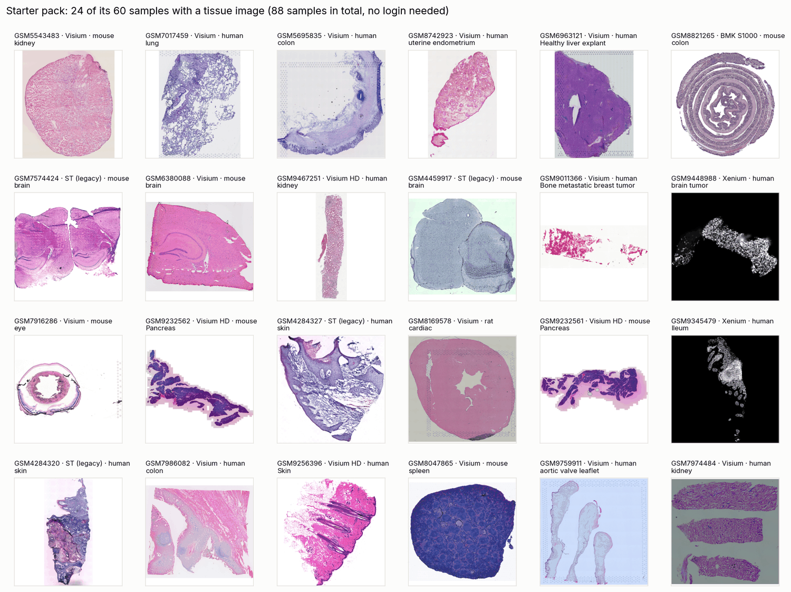
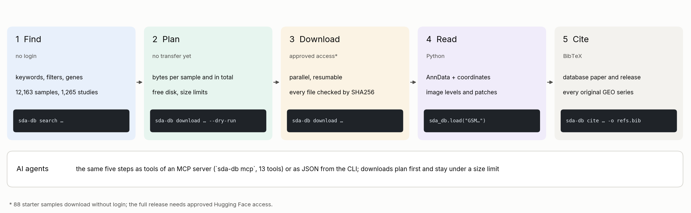
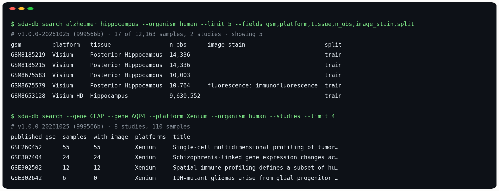
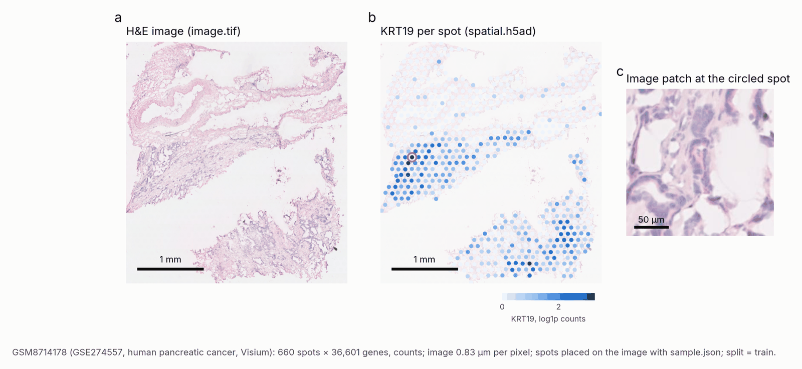
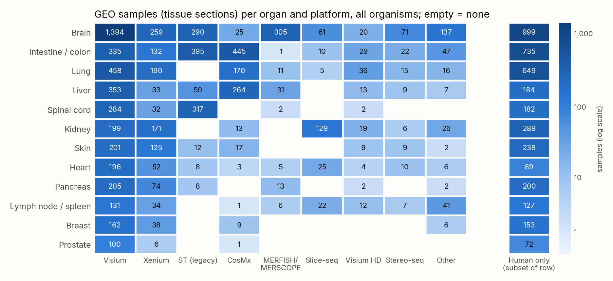
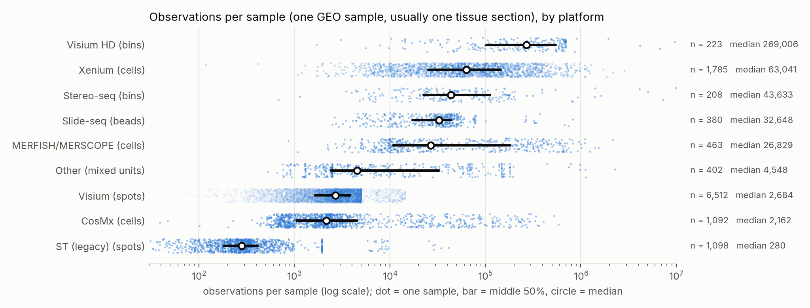

# SpatialDataAgent-DB 工具包

[](https://github.com/Biogod2020/spatial-data-agent-db/actions/workflows/tests.yml)
[](https://huggingface.co/datasets/Biogod/SpatialDataAgent-DB-Catalog)
[](https://doi.org/10.64898/2026.05.27.727615)
[](LICENSE)

本工具包用于查找、下载、校验、读取和引用 SpatialDataAgent-DB 中的样本。SpatialDataAgent-DB 是一个带版本的公共
空间转录组图谱。论文版本收录 **1,265 个 GEO 研究的 12,163 个样本**（NCBI GEO 中研究编号为 GSE，样本编号为 GSM），
涵盖 12 类平台（Visium、Visium HD、Xenium、CosMx、MERFISH/MERSCOPE、Slide-seq、Stereo-seq、legacy ST 等）。
**其中 8,211 个样本配有已配准的组织图像，5,263 个为 H&E。** 每个样本都有经过校验的表达矩阵、坐标和发布元数据。
[公开目录](https://huggingface.co/datasets/Biogod/SpatialDataAgent-DB-Catalog)人人可用；
[完整数据集](https://huggingface.co/datasets/Biogod/SpatialDataAgent-DB)需要获批的访问权限。



**检索不需要账号，上图所属的 88 个样本试用包也不需要。** 下载完整版本需要获批的访问权限（见[访问权限](#访问权限)）。

[English](README.md) · [命令行](docs/cli.md) · [Python API](docs/python-api.md) · [AI 智能体与 MCP](docs/agents.md) ·
[用例](docs/cookbook.md) · [数据字典](docs/data-dictionary.md) · [流式读取](docs/streaming.md) ·
[验证记录](docs/validation.md) · [更新日志](CHANGELOG.md)

## 工作流程



同一个包服务三类使用者：

- **研究者**：Python API，以及在终端输出易读表格的 CLI。
- **脚本**：JSON 输出、稳定的错误码、可复现的样本选择记录。
- **AI 智能体**：Model Context Protocol（MCP）服务器、精简 JSON 和智能体技能文件，让 Claude Code、Codex 等助手
  可以安全地检索、规划下载并读取样本。

## 安装

需要 Python 3.11 及以上：

```bash
pip install "spatial-data-agent-db[analysis] @ git+https://github.com/Biogod2020/spatial-data-agent-db"
```

`analysis` 附加项提供 AnnData、NumPy、pandas 和 tifffile，用于读取样本。只做检索和下载时，核心安装就够了。
也可以不安装，直接运行：

```bash
uvx --from "git+https://github.com/Biogod2020/spatial-data-agent-db" sda-db search alzheimer
```

## 五分钟试用，无需账号

试用包是论文版本中 88 个有代表性的样本：

- 12 类平台、20 类器官、8 个物种；
- 60 个样本带组织图像，其中 46 个为 H&E，8 个达到细胞分辨率（≤ 1 µm/像素）；
- 共 4.5 GB。

文件与门控版本逐字节相同。
[在 Colab 打开试用 notebook](https://colab.research.google.com/github/Biogod2020/spatial-data-agent-db/blob/main/examples/starter_pack.ipynb)，
或者：

```bash
sda-db starter --has-image                                    # 列出试用包
sda-db download GSM6963121 --release starter --include-image  # 人肝脏，Visium H&E，0.88 µm/像素
sda-db inspect GSM6963121 --release starter                   # 形状、坐标、质控、图像层级
```

在 Python 中同一个样本只需一行：`adata = sda_db.load("GSM6963121", release="starter", include_image=True)`
（去掉 `include_image` 则只取表达矩阵）。

## 一分钟上手命令行



*真实输出（加了 `--limit 5 --fields …` 以得到窄表）：一次带过滤条件的关键词排序检索，和一次按研究分组的基因检索。
两者都不需要登录。*

```bash
sda-db search alzheimer hippocampus --organism human        # 排序检索；不下载，不需登录
sda-db values tissue --platform Xenium --top 15            # 先看某个字段有哪些取值
sda-db search --gene GFAP --gene AQP4 --platform Xenium    # 面板同时测了这两个基因的样本
sda-db features GSM9448988 --contains CD                   # 不下载即可查看样本测了哪些基因
sda-db show GSM8185219                                     # 单个样本的全部信息
sda-db download GSM8185219 --dry-run                       # 传输前先看大小
sda-db download GSM8185219                                 # 按 SHA256 校验，并生成下载凭据
sda-db inspect GSM8185219                                  # 形状、坐标、质控、图像层级
sda-db search --stain "H&E" --where "split=train" --output he_train.json   # 3,847 个 H&E 训练集样本
sda-db search --platform "visium hd" --has-image --output cohort.json
sda-db download --from cohort.json --include-image --max-size 100GB
sda-db cite --from cohort.json -o refs.bib                 # 数据库及全部原始研究的引用
sda-db doctor                                              # 登录、权限、磁盘、网络诊断
```

在终端中输出表格；输出被管道接收时输出精简 JSON。脚本和智能体应传入 `--json` 以确保输出 JSON。结果写到 stdout，
日志和错误写到 stderr；错误是带稳定 `code` 的 JSON。检索结果如下（已缩短）：

```json
{"release": "v1.0.0-20261025", "commit": "999566bf…", "filters": ["image_stain=H&E", "has_image=True", "split=train"],
 "total": 3847, "shown": 2, "truncated": true,
 "samples": [{"gsm": "GSM4284316", "published_gse": "GSE144239", "platform": "ST (legacy)", "organism": "Homo sapiens",
              "tissue": "skin", "disease": "cSCC", "n_obs": 666, "image_stain": "H&E", "split": "train", "…": "…"}],
 "next": ["repeat with --output cohort.json to save all 3847", "…"]}
```

错误形如
`{"error": {"code": "not_found", "message": "...", "hint": "Run 'sda-db download GSM6963121' first."}}`。
命令之间可以通过样本编号串联：

```bash
sda-db search lung --platform Xenium --format ids | sda-db download --from - --dry-run
```

全部选项、JSON 格式和退出码见[命令行文档](docs/cli.md)。

## 一分钟上手 Python

```python
import sda_db

adata = sda_db.load("GSM6963121", release="starter")   # 无需登录；只取表达矩阵，保存到 ./downloads

catalog = sda_db.open_catalog()                  # v1.1.1-20261106：论文数据 + 元数据 v2；检索无需登录
hits = catalog.search("alzheimer hippocampus", organism="human", has_image=True)
print(hits)                                      # <Catalog release=v1.1.1-20261106 commit=999566b samples=... >
fibrosis = catalog.search(organ="lung", disease="fibrosis", min_confidence=0.6)   # 整理后的字段（见下文）
paper = sda_db.open_catalog("paper")             # 与论文完全一致的论文版本
hits.to_pandas()[["gsm", "tissue", "disease", "n_obs", "score"]]
hits.list_studies()                              # 每个 GEO 研究一行，含标题和 PubMed ID

train = catalog.search(image_stain="H&E", split="train")   # 3,847 个 H&E 训练集样本

# 下面两行需要完整数据集的访问权限：
print(hits.plan_download(include_image=True).to_dict(per_sample=False))   # 传输前先看大小
report = hits.download("downloads", include_image=True, max_bytes="50GB")
```

每个样本文件夹都有 `spatial.h5ad`（表达矩阵和坐标）和 `sample.json`（单位、质控和来源）。8,211 个带图像的样本
另有 `image.tif`，其 `sample.json` 给出把每个 spot 或细胞放到图像上的变换。只有传入 `include_image=True` 才会下载图像。

- `load()` 返回标准 AnnData（矩阵加注释），图像仍是 TIFF；不需要 scverse SpatialData。
- Scanpy（`import scanpy as sc`）可以用 `sc.pl.embedding(adata, basis="spatial")` 或
  `sc.pl.spatial(adata, spot_size=...)` 画出 `obsm['spatial']` 中的坐标。
- 图像不存放在 `adata.uns['spatial']` 中，所以 `sc.pl.spatial` 不会画出图像。要叠加图像，请用
  `image_coordinates()` 和图像辅助函数，它们也能切出与表达配对的图像块。



*a，H&E 图像。b，每个 spot 的 KRT19 计数，按 `sample.json` 放到图像上。c，圈中 spot 处的图像块。
示例样本为 GSM8714178（人胰腺癌，Visium，0.83 µm/像素）。*

下面的代码无需登录，可直接在试用样本上运行：

```python
import json
import sda_db
from sda_db.image import read_patch
from sda_db.io import image_coordinates

adata = sda_db.load("GSM6963121", release="starter", include_image=True)   # 保存到 ./downloads 并校验
meta = json.loads(adata.uns["sda_db"]["sample_json"])   # 以 JSON 字符串存储
pixels = image_coordinates(adata, meta)          # 每个 spot 在全分辨率（第 0 层）图像上的像素坐标
# "directory" 是存放 image.tif 的样本文件夹。尺寸单位是第 0 层像素（224 个）；
# info["um_per_px"]（此处为 0.88）可换算成微米。
patch, info = read_patch(adata.uns["sda_db"]["directory"], pixels[0], 224)
```

需要在磁盘预算内处理大量样本时，`catalog.stream(...)` 逐个交付已校验的样本，并预取下一个（见[流式读取](docs/streaming.md)）。
队列、数据划分、图像等更多用法见 [Python API](docs/python-api.md) 和[用例](docs/cookbook.md)。

## AI 智能体

注册一次 MCP 服务器，智能体即可检索、查看、规划、下载和引用样本：

```bash
claude mcp add sda-db -- sda-db mcp --download-dir ./sda-downloads --max-download-size 50GB   # Claude Code
```

如果智能体的 PATH 中没有 `sda-db`，可以改用 uvx 注册：

```bash
claude mcp add sda-db -- uvx --from "git+https://github.com/Biogod2020/spatial-data-agent-db" \
  sda-db mcp --download-dir ./sda-downloads --max-download-size 50GB
```

服务器不依赖额外的包。检索默认返回 20 行（最多 200 行），基因列表默认 100 个（最多 2,000 个），都带 `truncated`
标记，避免占满智能体的上下文。

它提供 13 个工具：`search_samples`（关键词、过滤条件和基因）、`field_values`、`list_fields`、`summarize`、
`get_sample`、`get_study`、`list_features`、`plan_download`、`download_samples`、`inspect_sample`、`cite`、
`list_releases` 和 `check_access`。下载遵循“先规划”：不带 `confirm=true` 调用 `download_samples` 只返回下载计划，
带 `confirm=true` 再调用一次才会传输。第二次调用智能体可以自己发起，所以真正的防线是你启动服务器时的设置：
单次调用超过 `--max-download-size`（默认 20GB）会被拒绝，文件只写入 `--download-dir`。`--no-allow-downloads`
会移除下载工具。Claude Desktop、Codex、Cursor、Gemini CLI 和 VS Code 的配置方法见 [AI 智能体与 MCP](docs/agents.md)。
不使用 MCP 的智能体可以调用 JSON 命令行，并阅读[智能体技能文件](skills/sda-db/SKILL.md)。

## 图谱里有什么



*GEO 组织描述与各器官匹配的样本数，按平台分列。右侧单独的一列是每行中的人类样本数。*



*每个样本的观测数。一个样本是一个 GEO 样本，通常是一张组织切片；观测随平台不同，可能是 spot、bin、bead 或细胞。*

## 检索语法

| 写法 | 含义 |
|---|---|
| `alzheimer hippocampus` | 关键词排序检索（BM25），范围包括组织、疾病、物种、平台、编号以及研究的标题、设计和摘要；所有词都必须命中 |
| `"spinal cord"` · `-mouse` · `neuro*` | 短语 · 排除 · 前缀 |
| `--platform "visium hd"` · `--organism human` | 精确值；忽略大小写、空格和连字符，接受常用名；重复即为“或” |
| `--tissue cortex` · `--disease glioma` | GEO 原文中的子串，不区分大小写 |
| `--gene GFAP --gene AQP4`（`--gene-any`） | 测量了这些特征的样本：基因符号或 Ensembl ID，不区分大小写；“测量了”不等于“检测到” |
| `--where "n_obs>=50000"` · `"split=train\|val"` · `"disease="` | 任意字段：`=`、`!=`、`~`（包含）、`!~`、`>`、`>=`、`<`、`<=`；`\|` 表示“或”；值为空表示缺失 |

检索是确定性的：首次下载目录后可离线运行，不调用任何模型。

- 拼错字段名或受控取值时会报错，并给出最接近的候选值（如 `platform='Visum'` → `'Visium', 'Visium HD'`）。
- 没有命中任何样本的检索词会在结果中注明，不会被悄悄丢弃。
- 论文中研究级的[意图检索](https://github.com/YSTLab/spatial-data-agent)是另一个基于模型的工具。

## 整理后的元数据 v2

默认版本 `v1.1.1-20261106` 就是论文版本（同一提交、同一批文件），外加一张整理后的元数据表
[metadata v2](https://huggingface.co/datasets/Biogod/SpatialDataAgent-DB-Catalog/tree/main/metadata/v2)
（版本 2.2，标签 `metadata-v2.2-20261106`，含人工审核后的更正），按 GSM 接到每个样本上。新增内容：

- `organ`（固定的 43 个器官）、`tissue_ontology_id`/`_name`（UBERON）和 `sample_kind`（原发组织、肿瘤组织、
  转移灶、类器官、异种移植等）；
- `disease_status`（normal / disease / perturbation / not stated）和 `disease_ontology_ids`/`_names`（MONDO）；
- `life_stage`、统一后的 `sex` 及其依据 `sex_source`、`donor_key`；`organism_taxon_id`、`organism_common_name`、`organisms`；
- `assay_name`、`assay_type`（基于成像或基于测序）、`preservation` 和 PubMed ID；
- 204 个样本的 `platform` 经过更正（原发布值保留在 `platform_v3`，同样有 `organism_v3`、`sex_v3`）；
- 每个字段的置信度、`annotation_low_confidence` 和 `metadata_flags`。

```bash
sda-db search human lung fibrosis Visium                     # 关键词也会匹配器官、UBERON 和 MONDO 名称
sda-db search --organ lung --disease fibrosis --min-confidence 0.6
sda-db search --disease MONDO:0004975 --disease-status disease --exclude-flags
sda-db values organ --sample-kind "tumour tissue"
```

`--disease` 接受 MONDO ID 或名称，名称也可以按不区分大小写的子串匹配。不展开上级术语，所以 `--disease cancer`
找不到 "carcinoma"。`--where "disease~TEXT"` 仍然检索 GEO 中报告的疾病原文。`--organism` 接受学名、俗名或
分类 ID，样本列出的任何一个宿主物种都算匹配。`--min-confidence 0.6` 去掉所有低置信度的判断；`--exclude-flags`
去掉带标记的样本，给出标记名则只去掉这些标记。

在 300 个随机样本的质检中，各字段的错误率为：器官 0.3%，组织术语 0.7%，样本类型 0.7%，生命阶段 1.7%，
疾病 3.0%。已知局限：研究层面的疾病有时会落到一个记录里没有标明为对照的对照样本上（约 1.5% 的样本）。
对照与疾病的划分很重要时，请查看 `disease_status_source` 和 GEO 原文。

**论文版本仍然可用，没有任何改动：** `--release paper`（或 `v1.0.0-20261025`）只给出 v3 元数据，与论文完全一致。
用到 v2 时，`sda-db cite` 会写明元数据 v2 的标签。

## 版本与可复现性

| 版本 | 提交 | 样本数 | 说明 |
|---|---|---:|---|
| `v1.1.1-20261106`（默认；别名 `metadata-v2`、`metadata-v2.2`、`v1.1`） | `999566b` | 12,163 | 论文数据和文件，外加整理后的元数据 v2.2（标签 `metadata-v2.2-20261106`） |
| `v1.1.0-20261105`（别名 `metadata-v2.1`、`v1.1.0`） | `999566b` | 12,163 | 同一数据加元数据 v2.1（标签 `metadata-v2.1-20261105`），即客户端 0.4.0 的默认版本；为可复现保留 |
| `v1.0.0-20261025`（别名 `paper`、`v1`） | `999566b` | 12,163 | 论文发布时的原样（v3 元数据）；目录公开并以 SHA256 绑定，文件需要访问权限 |
| `latest` | 打开时解析 | 持续增长 | 每日新增经审核样本的滚动版本；需要访问权限 |

每个样本选择、下载记录和引用都会写明版本名和完整提交号。用 `--release` 或 `open_catalog(release=...)` 选择版本。
`Catalog.from_selection("cohort.json")` 会按原版本和原提交重新打开目录，并选出同一批样本。只给提交号（如 `999566b…`）
打开的是不带元数据 v2 的论文版本。下载写入 `downloads/<commit>/samples/<GSE>/<GSM>/`，并附带记录每个文件哈希的凭据。

## 访问权限

完整版本的文件在 Hugging Face 上，需要人工审核，并要求账号中有已验证的机构邮箱：

1. 在[数据集页面](https://huggingface.co/datasets/Biogod/SpatialDataAgent-DB)提交申请。
2. 获批后运行 `hf auth login`，或设置 `HF_TOKEN`。
3. 运行 `sda-db doctor` 确认可以下载。

不要把 token 写进脚本或命令参数。详见[访问与排错](docs/access.md)。

## 正确理解数据

- `X` 不一定都是原始计数，请查看 `expression_state`（counts / non-integer / unknown）和 `verification`。
- `obsm['spatial']` 保留原始单位（`coordinate_units`：um / pixel / native_grid / unstated）。只有记录了微米信息时
  才有微米坐标，其依据见 `um_basis`。
- 观测可能是 spot、bin、cell 或 bead（`observation_unit`），不都是细胞。
- 图像是可选项，需要显式下载。`image.spatial_to_pixel` 把原始 x/y 映射到第 0 层像素；根据像素推断的染色标签会注明。
- 做机器学习时请保留发布版本的 `split`（按整个 GEO 研究分到 train、val 或 test），并让同一研究的样本留在一起。
  `aliases` 列出与该样本内容完全相同的其他 GSM，`content_group` 是这一组的名称。版本中每组只保留一个样本，
  所以不需要再按这些编号去重。
- 结构校验、图像配准和人工审核是三个独立字段；审核为空不等于审核通过。

详见[数据字典](docs/data-dictionary.md)和[复用指南](docs/reuse.md)。

## 引用

`sda-db cite` 会为所选样本生成 BibTeX，内容包括数据库论文、所用版本以及每个 GEO 研究。请同时引用原始研究。论文：

> Ji J-H, Zou Q, Cheng J, et al. *An agent-built, verified atlas of public spatial transcriptomics shows
> that breadth across studies drives transfer and reproducibility.* bioRxiv (2026).
> [doi:10.64898/2026.05.27.727615](https://doi.org/10.64898/2026.05.27.727615)

## 许可证

工具包代码采用 [MIT 许可证](LICENSE)。数据仍遵循数据集卡片和各原始研究的条款，不受该许可证约束。

## 开发

```bash
python -m pip install -e '.[analysis]'
python -m unittest discover -s tests -v
```

测试全部离线进行，使用合成数据，覆盖检索、过滤、版本、下载计划、并行下载、完整性校验、命令行约定、MCP 协议和图像读取。
在 Hub 上实际运行的检查记录在[验证记录](docs/validation.md)中。本仓库是 [SpatialDataAgent](https://github.com/YSTLab/spatial-data-agent)
面向用户的配套工具，后者负责构建图谱。
参与贡献见 [CONTRIBUTING.md](CONTRIBUTING.md)。
